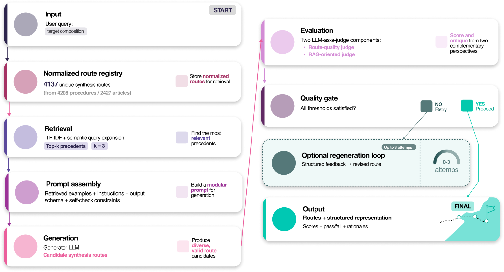

# SynthWay


We present SynthWay, a framework integrating composition-aware inorganic synthesis design with reliable evaluation of LLM-generated routes, built on 4,208 literature procedures. SynthWay combines retrieval, modular prompting, LLM generation and automatic evaluation, with optional feedback-driven regeneration.

This repository provides the source code, curated synthesis data, recorded model outputs, expert assessments, laboratory validation records, and analysis scripts supporting the SynthWay study.

[Overview](#overview), [Installation and usage](#installation-and-usage), [Reproduce the tables](#reproduce-the-tables), [Data availability](#data-availability), [Code availability](#code-availability)

## Overview

Given a target composition such as `Ag`, SynthWay retrieves relevant literature procedures, assembles a modular prompt, and generates candidate synthesis routes. The application evaluates chemical plausibility, Answer Relevancy, and SS-Faithfulness (synthesis-specific Faithfulness) against retrieved procedures. Optional regeneration uses structured feedback to revise a route.

The study examines evaluation reliability through comparisons with expert assessments and laboratory outcomes, including a synthesis-specific Faithfulness rubric aligned with the expert criteria.



An optional [recorded Ag synthesis example](docs/recorded_example.md) shows a saved protocol, its evaluations, and the laboratory outcome without an API key.

## Installation and usage

### Set up the environment

The software was tested with Python 3.12 on macOS 15.6 (Apple M3 Pro, 18 GB RAM). The live demo runs on CPU and needs about 3 GB for dependencies and model weights. Installation took about three minutes on the tested machine, plus about two minutes for the first model download.

Run these commands from the repository root:

```sh
python3.12 -m venv .venv
source .venv/bin/activate
python -m pip install -r requirements.txt
```

On Windows Command Prompt, use `py -3.12 -m venv .venv` and activate with `.venv\Scripts\activate.bat`. The desktop application also requires Tkinter, supplied by the Python installation.

### Generate and evaluate a new route

Create a local `.env` file using [.env.example](.env.example) and set `OPENROUTER_API_KEY`. Internet access and an OpenRouter account with access to the selected models are required; model calls are billable.

Check the installed dependencies and key presence, then run the demo:

```sh
python scripts/demo.py --check
python scripts/demo.py --out outputs/demo
```

The local `--check` does not call a model or verify account credits. The live demo uses the [Ag input](data/demo/input.json) and [three supplied procedures](data/demo/corpus/) to build a retrieval index, generate one route, and calculate chemical plausibility, Answer Relevancy, and SS-Faithfulness scores. It writes the route, retrieval context, scores, logs, and `summary.json` under `outputs/demo/`. The [expected output specification](data/demo/expected_output.json) defines the required files and fields; passing this check means the run completed correctly, even if a route falls below a quality threshold.

The measured runtime was about six minutes with cached model weights. To run again, use a new output directory. New routes and scores can vary between runs.

### Use the desktop application

With the environment active and the API key configured, run:

```sh
python synthway/synthpath_gui.py
```

Enter a target composition such as `Ag`, select the generator and judge, and click **Run**. The application uses the supplied retrieval index. An [annotated interface](results/figures/figure_s3.png) is included with the manuscript figures.

### SS-Faithfulness and regeneration

The application, live demo, and [regeneration script](synthway/regenerate_runs/scripts/regenerate_cross_judge_expert_faithfulness.py) use the study's [SS-Faithfulness implementation](synthway/bench/new_faith_same_as_expert_logic.py). The score combines four synthesis-specific criteria: `(3*Q1 + 2*Q2 + 2*Q3 + Q4) / 8`. Regeneration uses the scores and explanations to revise routes that fail the evaluation thresholds.

For direct SS-Faithfulness evaluation, select `--faithfulness-mode ss` in `synthway/evaluate_answer_faithfulness_deepeval.py`.

## Reproduce the tables

The table calculations use saved study data and run offline. If you only want to reproduce these tables, create and activate the Python 3.12 environment described above and install the smaller table-analysis requirements:

```sh
python -m pip install -r paper_tables/requirements.txt
python paper_tables/analysis/reproduce.py
```

This calculates **12 tables: Table 1, S8–S11, and S13–S19**, and saves the CSVs in `paper_tables/generated/`.

The remaining table and figure sources are listed below. With the full requirements installed, the following scripts redraw selected plots from the saved results:

| Figure | Command |
|---|---|
| 3 | `python scripts/plot_benchmark.py` |
| 5 and S6 | `python scripts/plot_regeneration.py` |
| S2 | `python scripts/plot_graph_labels.py` |

Figure 3 summarizes the initial screening of 12 models using CPC, Answer Relevancy, and original Faithfulness. Cost and time include evaluation only. SS-Faithfulness is used for the synthesis-specific assessment and feedback-driven regeneration.

To recalculate the Figure 3 data and update the [PNG](results/figures/figure_3.png), run `python scripts/plot_benchmark.py --from-records`.

## Data availability

The [curated synthesis registry](data/merged_all.xlsx) contains 4,208 literature procedures, with one procedure per distinct `synthesis_id`. The repository includes the [procedure records](synthway/json/), [knowledge graph](graph_output/graph.graphml), [retrieval index](synthway/index/) containing 4,137 normalized route records, and [30 benchmark cases](synthway/output_analysis/stratified_dataset/stratified_dataset.jsonl).

### Tables

Saved CSVs for **Table 1, S8–S11, and S13–S19** are in [paper_tables/reference/](paper_tables/reference/). Additional tables **S2–S4, S6–S7, S12, and S20–S21** are in [results/source_data/](results/source_data/). These files can be opened directly. New table calculations are saved separately in `paper_tables/generated/` by the [reproduction command](#reproduce-the-tables).

The table calculations use eight prepared input files in [paper_tables/data/](paper_tables/data/). The links below identify the saved tables and their inputs. Calculations for S8–S11 and S13–S19 are implemented in [reproduce.py](paper_tables/analysis/reproduce.py).

| Manuscript table | Table files, inputs, and calculations |
|---|---|
| 1 | [Table 1 CSV](paper_tables/reference/Table_1.csv), [judge ratings](paper_tables/data/Table_1_Judge_Ratings.xlsx), [expert scores](paper_tables/data/experts_mean_median_scores_detailed_thr_08.xlsx), [calculation code](paper_tables/analysis/calculate_table_1.py) and [recorded Claude–Llama evaluations](paper_tables/examples/Claude_Llama_evaluations.json) |
| S8–S9 | [Saved table CSVs](paper_tables/reference/) and [scores across generation runs](paper_tables/data/pipeline_ratings.csv) |
| S10 | [Table S10](paper_tables/reference/Table_S10.csv) and [repeated ratings of fixed routes](paper_tables/data/fixed_route_ratings.csv) |
| S11 | [Table S11](paper_tables/reference/Table_S11.csv) and [paired context-order evaluations](paper_tables/data/context_pairs.csv) |
| S13–S17 | [Saved table CSVs](paper_tables/reference/), [self-judge ratings](paper_tables/data/self_judge_ratings.csv), [expert scores](paper_tables/data/experts_mean_median_scores_detailed_thr_08.xlsx) and [40 evaluated protocols](synthway/bench/diff_judges_for_exp_bench/selected_40_routes_for_expert_eval/) |
| S18–S19 | [Saved table CSVs](paper_tables/reference/), [cross-judge ratings](paper_tables/data/cross_judge_ratings.csv), [route means](paper_tables/data/cross_judge_route_means.csv) and [expert scores](paper_tables/data/experts_mean_median_scores_detailed_thr_08.xlsx) |
| S1–S3 | [Synthesis fields](data/parameters.csv), [field coverage](results/source_data/table_s02.csv) and [graph sizes](results/source_data/table_s03.csv) |
| S4–S5 | [Retrieval performance](results/source_data/table_s04.csv) and [benchmark categories](data/benchmark_categories.csv) |
| S6–S7 | [Benchmark scores](results/source_data/table_s06.csv), [route scores](results/source_data/benchmark_selected_routes.csv), [resource use](results/source_data/table_s07.csv) and [individual observations](results/benchmark_resource_observations.csv) |
| S12 | [Expert agreement](results/source_data/table_s12.csv) and [rating matrices](results/analysis/expert_reliability/) |
| S20–S21 | [Laboratory protocols and scores](results/source_data/table_s20.csv) and [model identifiers and dates](results/source_data/table_s21.csv) |

### Figures

Ready-to-view images for **Figures 1–5 and S1–S6** are in [results/figures/](results/figures/). The image links below open the figures directly; numerical data and relevant source code are listed alongside them.

| Figure | Image                                                                                                                              | Source data or code |
|---|------------------------------------------------------------------------------------------------------------------------------------|---|
| 1 | [Figure 1](results/figures/figure_1.png)                                                                                           | [Parameter coverage](results/source_data/figure_1.csv) |
| 2 | [Figure 2](results/figures/figure_2.png)                                                                                           | Workflow diagram |
| 3 | [Figure 3 (PNG)](results/figures/figure_3.png)                                                                                     | [Benchmark plot data](results/source_data/figure_3.csv) |
| 4, S4, S5 | [Figure 4](results/figures/figure_4.jpg), [Figure S4](results/figures/figure_s4.png), [Figure S5](results/figures/figure_s5.png)   | [Six experimental outcomes](results/source_data/figure_4_outcomes.csv) |
| 5, S6 | [Figure 5](results/figures/figure_5.png), [Figure S6](results/figures/figure_s6.png)                                               | [Acceptance by step](results/source_data/figure_5a.csv), [individual repeats](results/source_data/figure_5a_repeats.csv) and [paired route scores](results/source_data/figure_5b_s6.csv) |
| S1–S3 | [Figure S1](results/figures/figure_s1.png), [Figure S2](results/figures/figure_s2.png), [Figure S3](results/figures/figure_s3.png) | [Node counts by parameter](results/source_data/figure_s2.csv); S3 shows the annotated application interface |
| S7–S14 | Source code provided                                                                                                               | [Generation prompt components (S7–S13)](synthway/prompt.py) and [chemical plausibility rubric (S14)](synthway/evaluate_generation_deepeval.py) |

XRD, SEM and EDS data are available as manuscript panels only.

## Code availability

Version 1.0.0 includes the following components:

| Component | Code |
|---|---|
| Knowledge graph construction | [Guide and scripts](graph_reasoning/README.md) |
| Retrieval index construction | [build_rag_index.py](synthway/build_rag_index.py) |
| Modular prompting and route generation | [prompt.py](synthway/prompt.py), [predictions.py](synthway/predictions.py) |
| Chemical plausibility evaluation | [evaluate_generation_deepeval.py](synthway/evaluate_generation_deepeval.py) |
| Answer Relevancy and prescreening Faithfulness | [evaluate_answer_faithfulness_deepeval.py](synthway/evaluate_answer_faithfulness_deepeval.py) |
| SS-Faithfulness | [new_faith_same_as_expert_logic.py](synthway/bench/new_faith_same_as_expert_logic.py) |
| Feedback-driven regeneration | [regenerate_cross_judge_expert_faithfulness.py](synthway/regenerate_runs/scripts/regenerate_cross_judge_expert_faithfulness.py) |
| Table calculations | [paper_tables/analysis/](paper_tables/analysis/) |

## Citation

Citation details will be added after publication.
